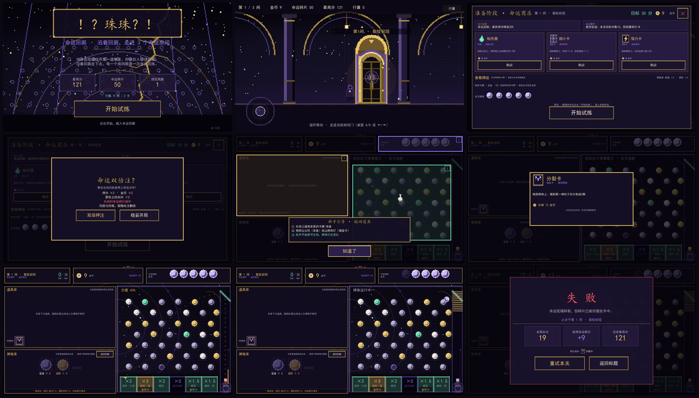

# ！？珠珠？！ · 命运回廊 · 弹珠试炼

[](https://godotengine.org/)
[](#)
[](CHANGELOG.md)

> 手机端 **横屏像素风** 弹珠肉鸽（Pachinko × Roguelike）游戏。
> 把命运琉璃珠射进弹珠台，看它撞在哪里、落进哪个洞——那就是你的命。



---

## 这是什么

每个人出生时都有一颗**命运琉璃珠**，代表一生的命运。当琉璃珠出现裂痕，持有者会被拉入**命运回廊**——一座超脱现世、无限堆叠的巨型弹珠神殿。

回廊里，巨大的弹珠台就是命运本身：**立柱是相遇与磨砺，槽位是结果，虚空大坑是彻底的失败**。守命者会在台上巡游，撞偏你的弹珠，不让你改变命运。

你要做的，是在有限的弹珠里打出足够的分，一关一关走完回廊。

---

## 玩法

```
主菜单「开始试炼」
  → 2D 像素走廊：虚拟摇杆左右移动，走到门边进房间
  → 【准备阶段】上半屏购物、下半屏看牌组
      点「开始试炼」→ 弹出「命运双倍注？」（双倍押注 / 稳妥开局）
  → 【正式游玩】按住右下弹簧蓄力（力度来回摆动 + 虚线轨迹预判）→ 松手发射
      → 沿轨道上行 → 顶部导流斜面 → 缺口关闭 → 错落立柱阵
      → 落入底部 6 个随机框结算
  → 达标立即过关（+5 金币，剩余弹珠入库）→ 回走廊，下一扇门解锁
  → 3 间全通：胜利结算；5 颗弹珠用完未达标：失败结算
  → 一局结束：部分弹珠/卡牌进入「行囊」（跨局公共变量），可勾选带入下一局
```

### 核心机制

| 机制 | 说明 |
| --- | --- |
| **错落立柱** | 6 列 × 7 行 = 42 根，奇数行横移半列距 |
| **五种立柱** | 普通（仅反弹）/ 黄色（每撞一次本球基础分 +1）/ 绿色（相邻绿柱间有真实碰撞连线，撞线再反弹）/ 黑色（每撞一次最终得分 −1）/ 白色（每撞按 20%+10%×已撞次数 概率 +1 金币） |
| **随机落入框** | 每关 6 个框的倍率（0 / 1 / 1.5 / 2 / 3 / 5）与奖励（无 / 金币 +2 / 再射一球）全部随机 |
| **卡牌** | 强力（力度 +30%）、分裂（撞首柱分裂 3 颗）、质量（低反弹 / 免疫粘性）、缩小（体积 ×0.8 / 速度 ×1.2）—— 拖到弹珠灯生效 |
| **装备** | 反射器（反弹增强）、粘性器（黏住约 0.9s）—— 拖到立柱生效 |
| **弹珠** | 普通珠基础分 5，进阶珠 10（3 颗普通珠合成）；双倍注下得分 ×2 |
| **双倍注** | 买完道具点「开始试炼」时选择：得分 ×2、金币 ×2、黑柱惩罚 ×2、失败碎片减半 |
| **局外行囊** | 一局结束最多带出 3 珠 + 2 卡，下局开局可勾选带入（弹珠 ≤3、卡牌 ≤2） |

### 关卡

| 关卡 | 名称 | 目标分 | 关卡 buff |
| --- | --- | --- | --- |
| 1 | 裂纹初现 | 25 | 最终得分 ×0.8 |
| 2 | 因果倒错 | 38 | 弹珠基础分 ×1.2 |
| 3 | 无柱之渊 | 45 | 普通立柱全部消失（只剩黄 / 绿） |

初始金币 9，每关发 5 枚弹珠，过关奖励 5 金币。每关开始随机抽一张**命运事件**，会改变本关规则（+球 / +金币 / 黄柱加成 / 目标分变化 / 额外碎片）。

存档（最高分、累计命运碎片、游玩局数）写入 `user://fate_save.json`。

---

## 技术栈

| 项 | 值 |
| --- | --- |
| 引擎 | Godot **4.6.3** stable（Mobile 渲染器） |
| 分辨率 | 1280×720，`canvas_items / keep` 自适应全面屏，锁定横屏 |
| 美术 | 像素风：低分辨率逐像素绘制 → NEAREST 放大；UI 面板方角硬边框、无阴影 |
| 音频 | 8bit / chiptune：方波 + 三角波贝斯 + 噪声鼓 + 快速琶音（5 首 BGM + 13 个音效） |
| 目标平台 | Android，arm64-v8a，minSdk 24 / targetSdk 36 |
| 语言 | GDScript |

---

## 快速开始

### 编辑器运行

1. 安装 [Godot 4.6.3](https://godotengine.org/download)（标准版即可，不需要 .NET）
2. 打开 Godot →「导入」→ 选择本目录的 `project.godot`
3. 按 F5 运行，主场景为 `scenes/main_menu.tscn`

```bash
# 或者命令行启动
godot --path . --resolution 1280x720
```

> 首次打开时 Godot 会重新导入资源（生成 `.godot/` 缓存目录），耗时约 1–2 分钟。该目录已被 `.gitignore` 排除。

### 构建 APK

需要先配置 Android 导出模板（Godot 编辑器 → 编辑器 → 管理导出模板）。

```powershell
powershell -ExecutionPolicy Bypass -File tools/build_apk.ps1
```

导出配置见 `export_presets.cfg`，详细说明见 [`build/RELEASE_EXPORT.md`](build/RELEASE_EXPORT.md)。

### 安装试玩

**APK 在 [Releases](../../releases) 页面下载**，不在仓库内（构建产物不入库，避免仓库膨胀）。

装到手机 → 允许未知来源 → 安装 → 启动（自动横屏）。

---

## 操作

| 操作 | 说明 |
| --- | --- |
| 走廊摇杆拖动 / A·D / ←·→ | 移动，走到门边进房间 |
| 走廊「行囊」 | 查看 / 勾选局外弹珠与卡牌 |
| 「购买」 | 准备阶段购买道具 / 卡牌 |
| 「开始试炼」/ ❌ | 弹出双倍注对话框，选择后进入发射 |
| 按住右下弹簧 | 蓄力（力度来回摆动，看轨迹预判），松手发射 |
| 长按 ⑦ 装备拖到立柱 | 反射器 / 粘性器生效 |
| 长按 ⑦ 卡牌拖到 ③ 弹珠灯 | 该弹珠获得卡牌效果（灯变红 + 卡名） |
| 短按 ⑦ 待使用道具 | 查看卡牌详情 |
| 长按 ⑧ 弹珠拖到 ③ 灯 / 选 3 颗合成 | 替换弹珠 / 合成进阶弹珠 |
| 结算 / 返回 / ESC / 安卓返回键 | 重试本关、回标题 |

---

## 项目结构

```
project.godot               # Godot 工程配置（主场景、Autoload、分辨率）
export_presets.cfg          # Android 导出预设
icon.png / icon.svg         # 应用图标

scripts/
  autoload/
    game_state.gd           # 全局状态：弹珠槽 / 卡牌 / 随机框 / 行囊 / 双倍注 / 引导
    audio.gd                # 8bit BGM 与音效管理器
  core/
    fate_config.gd          # P1 布局常量、5 种立柱、随机框池、卡牌、双倍注、引导文案
  gameplay/                 # 弹珠、台面、立柱、发射器、守命者、结算、像素绘制工具(px.gd)
  corridor/                 # 像素走廊、虚拟摇杆、玩家、行囊入口
  ui/                       # 像素主题、主菜单、HUD、准备阶段、行囊面板、引导、结算

scenes/
  main_menu.tscn  corridor.tscn  game.tscn
  ui/  hud / prep / meta_panel / tutorial / result

assets/
  art/                      # 像素美术（含引导小手 ui_hand.png）
  audio/                    # 8bit BGM 5 首（OGG）+ 13 个音效（WAV）
  fonts/                    # 中文标题体与正文体
  ui/                       # UI 贴图

tools/
  gen_art.py                # 像素美术生成脚本
  gen_audio.py              # chiptune 音频生成脚本
  gen_icon.py               # 图标生成脚本
  build_apk.ps1             # 一键构建 APK
  qa_*.gd                   # 平衡性 / 音频 / 截图 自测脚本

docs/                       # 设计文档、验收契约、各版本截图
build/                      # 构建日志与导出说明（APK 本身不入库）
```

---

## 文档

| 文件 | 内容 |
| --- | --- |
| [`docs/DESIGN.md`](docs/DESIGN.md) | 世界观、核心玩法、关卡数值、肉鸽元素设计 |
| [`docs/README.md`](docs/README.md) | v1.3 完整验收说明：改动清单、P1 布局坐标表、操作、自测结果 |
| [`docs/CONTRACT.md`](docs/CONTRACT.md) ~ [`CONTRACT_V4.md`](docs/CONTRACT_V4.md) | 各版本开发契约（需求 → 实现的对应关系） |
| [`build/RELEASE_EXPORT.md`](build/RELEASE_EXPORT.md) | Android 导出与签名流程 |
| [`docs/screenshots_v13/`](docs/screenshots_v13/) | v1.3 实机截图（12 张 + 联系表） |

历史版本截图在 `docs/screenshots/`、`screenshots_v11/`、`screenshots_v12/`。

---

## 已知简化

- 像素风使用现有中文字体（暂无合适的像素 CJK 字体），仅贴图与面板做了像素化。
- 轨迹预判是近似抛物线，不含立柱与守命者的碰撞，仅作瞄准参考。
- 绿柱连线用线段碰撞实现反弹；走廊没有战斗与跳跃，只做移动与进门。
- APK 为 **debug 签名**（试玩分发用），正式上架需要自己的 keystore。

---

## 许可

本项目暂未声明开源许可。如需转载或复用，请先联系作者。
